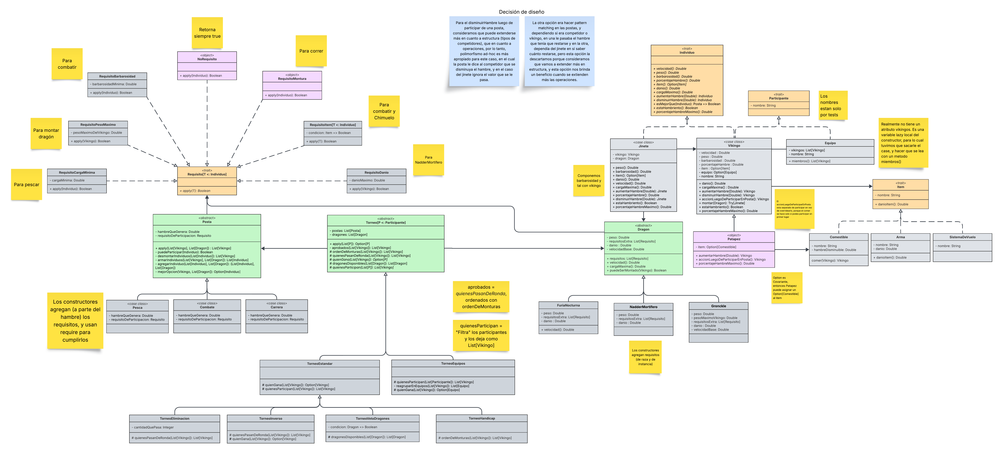
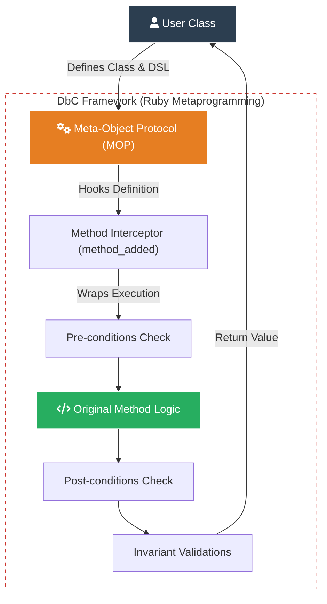

# Advanced Programming Paradigms (Meta-Object Protocol & Functional Domain)

Colección de implementaciones de diseño de software avanzado. Este proyecto explora los límites de la Orientación a Objetos clásica, extendiendo el lenguaje base mediante **Metaprogramación en Ruby** y construyendo motores de reglas libres de efectos colaterales mediante **Programación Funcional Pura en Scala**.


## 📑 Índice
- [El Problema y la Motivación](#problema)
- [Tech Stack y Paradigmas](#tech-stack)
- [Features Clave](#features)
- [Aprendizajes Clave y Roadmap](#aprendizajes)
- [Visuales, Diagramas y Documentación Anexa](#visuales)
- [Instalación y Ejecución Local](#instalacion)

<a name="problema"></a>
## 🧠 El Problema y la Motivación

La programación orientada a objetos monolítica tiende a generar código frágil cuando se cruzan responsabilidades (ej. validaciones de negocio acopladas a la lógica de dominio) o cuando el estado mutable provoca efectos colaterales impredecibles (side-effects) en sistemas altamente paralelizables. 

Este proyecto se divide en dos módulos independientes que atacan estos problemas con diferentes paradigmas arquitectónicos:
1.  **Módulo Ruby (Framework DbC):** Desarrollar un framework que inyecte validaciones en tiempo de ejecución de manera transparente (Design by Contract), separando el control de calidad de la lógica de negocio pura.
2.  **Módulo Scala (Motor de Reglas Funcional):** Diseñar un motor matemático para procesar torneos complejos ("Festival de Invierno") garantizando consistencia total mediante estados inmutables y tuberías de funciones puras.

<a name="tech-stack"></a>
## 🏗️ Tech Stack y Paradigmas

*    **Core de Extensión (Stateful OOP & MOP):** Utilización del *Meta-Object Protocol* (MOP) de Ruby. El framework evalúa y altera clases dinámicamente en tiempo de ejecución (Monkey-patching y Hooks) manteniendo el estado interno de los objetos.
*    **Dominio Computacional (Stateless / Functional):** Lenguaje altamente tipado ejecutado sobre la JVM. Orquesta el dominio utilizando *Algebraic Data Types (ADT)* y *Pattern Matching* para resolver la lógica funcional sin almacenar estado en los modelos.
*    **Quality Assurance (TDD):** Ecosistemas de testing unitario riguroso aislando invariantes, precondiciones y comportamiento matemático puro.

<a name="features"></a>
## ⚡ Features Clave

### Framework de Diseño por Contratos (Ruby)
*   **Intercepción Dinámica de Mensajes:** Uso de metaprogramación para alterar el comportamiento de las clases envolviendo dinámicamente la definición de métodos. Se inyectan *Callbacks* (Before/After) sin modificar el código original del desarrollador.
*   **Evaluación de Invariantes Declarativas:** Creación de un Domain-Specific Language (DSL) interno en Ruby que permite declarar reglas de consistencia de negocio a nivel clase, bloqueando ejecuciones que puedan dejar al objeto en un estado corrupto.

### Motor Híbrido Objeto-Funcional (Scala)
*   **Pipelines de Computación Inmutable (Stateless):** Toda transformación en el dominio matemático de los torneos genera un nuevo estado. Las funciones no producen *Side Effects*, garantizando determinismo absoluto para su eventual paralelización.
*   **Pattern Matching Avanzado:** Evaluación estructural de las entidades mediante tipos algebraicos y polimorfismo paramétrico, resolviendo reglas de negocio complejas (eliminatorias, penalizaciones, vetos) con alta cohesividad funcional.
*   **Funciones de Orden Superior:** Tratamiento de las funciones lógicas y eventos como ciudadanos de primera clase, permitiendo componer dinámicamente las rondas y torneos mediante combinadores funcionales (`map`, `fold`, `filter`).

<a name="aprendizajes"></a>
## 📈 Aprendizajes Clave y Roadmap

*   **Manipulación de la Tabla de Símbolos (Ruby):** Interceptar el flujo de *method_added* me enseñó los riesgos y beneficios extremos del *Monkey Patching* profundo, subrayando la importancia de restaurar el entorno para evitar colapsos en la máquina virtual de Ruby.
*   **Tipeado Fuerte vs Dinámico:** Pasar de construir un DSL dinámico donde todo está permitido (Ruby) a un compilador que no permite fisuras en el modelado algebraico (Scala) brindó una perspectiva arquitectónica invaluable sobre qué herramienta utilizar según el contexto de criticidad del negocio.

<a name="visuales"></a>
## 🖼️ Visuales, Diagramas y Documentación Anexa

<div align="center">
  <h4>Módulo Scala (Festival de Invierno) - Diagrama de Clases Estructural</h4>
  
  <br><br>
  
  <h4>Módulo Ruby (Contratos) - Arquitectura del Meta-Object Protocol</h4>
</div>



<a name="instalacion"></a>
## ⚙️ Instalación y Ejecución Local

### Ejecución del Módulo Ruby (Contratos)
Requiere un entorno con Ruby (recomendado versión 3.x) y Bundler instalado.

```bash
# 1. Acceder al módulo
cd ruby

# 2. Instalar el framework de testing
gem install bundler
bundle install

# 3. Ejecutar la suite de tests (Demostración del framework)
rspec
```

### Ejecución del Módulo Scala (Festival de Invierno)
Requiere Java SDK (JVM) y **SBT (Scala Build Tool)** instalados en el sistema.

```bash
# 1. Acceder al módulo
cd scala

# 2. Ejecutar la consola interactiva (REPL) cargando el dominio
sbt console

# 3. Correr las pruebas automatizadas (ScalaTest)
sbt test
```
